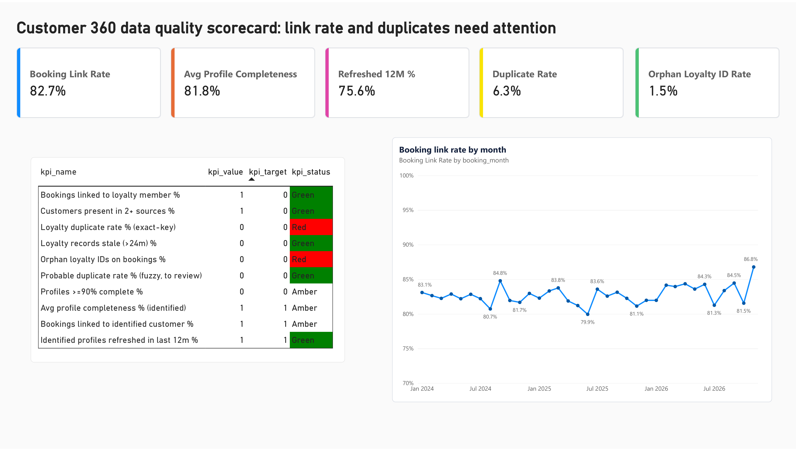
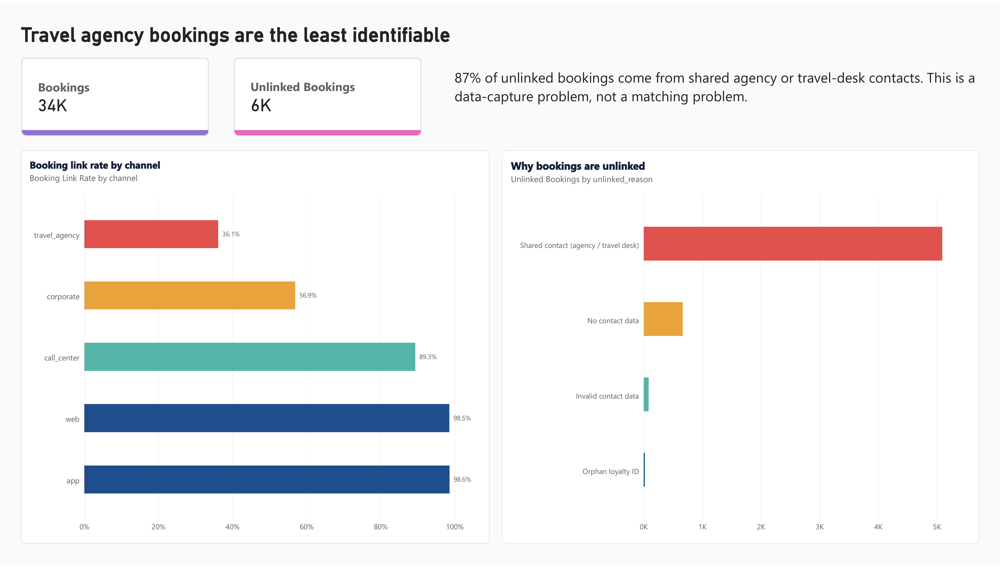
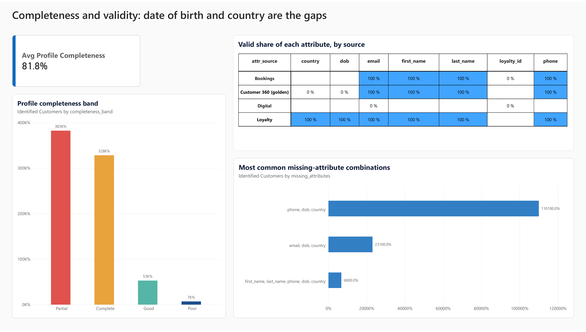
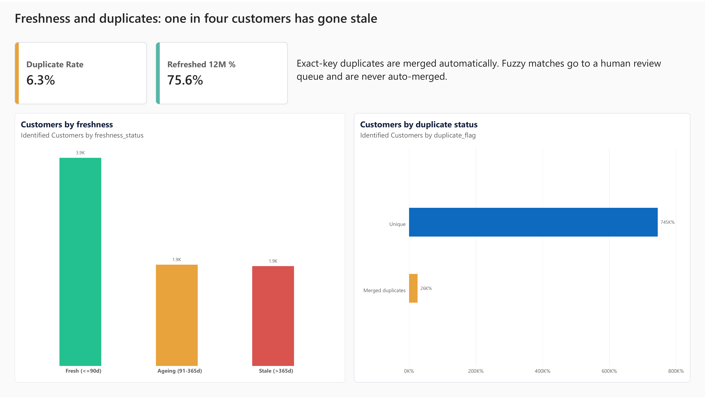
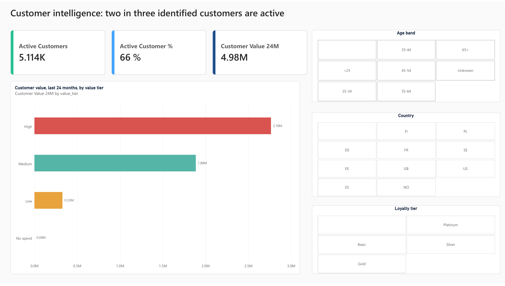

# Customer 360 Data Quality Project

## What is this project?

An airline keeps customer data in three places: bookings (name, email), the loyalty programme (member records), and the website/app (what people do). The same person can appear in all three with nothing linking them.

This project joins the three sources into one customer view and then measures how good that data is: how complete it is, how fresh it is, how many duplicates there are, and how many bookings can be tied to a known customer.

All data is made up. A script generates it and adds realistic mistakes on purpose (missing emails, typos, fake phone numbers, duplicate members, shared agency mailboxes). No real customer data is used.

Tools: Python (Pandas), SQL (SQLite), Excel, Power BI.

## How it works

1. **Make the data.** `src/01_generate_data.py` creates about 34k bookings, 4k loyalty members and 53k web/app events. It also saves the true answer (which records belong to which person) so I can check my matching later.
2. **Clean it.** Emails, phones, names, dates and countries are put in one format. Values like "N/A" or "0000000000" count as missing.
3. **Match records to people.** Records are linked by loyalty ID, email, or phone plus surname. Emails shared by many different surnames (travel agencies, company travel desks) are ignored, otherwise strangers would be merged into one customer. Pairs that only look similar go to a review list and are not merged automatically.
4. **Build one profile per customer.** For each field I take the best valid value, in the order loyalty, bookings, web/app.
5. **Measure quality.** Completeness, validity, duplicates, freshness, and the share of bookings linked to a customer.
6. **Check in SQL.** The same numbers are calculated again with SQL and compared with the Pandas results. They match.
7. **Write the definitions.** An Excel workbook defines terms like "active customer" and "customer value" and holds the scorecard.
8. **Dashboard.** The output tables go into Power BI.

## What I found

| Measure | Result | Target I set |
|---|---|---|
| Bookings linked to a known customer | 82.7% | 90% |
| Average profile completeness | 81.8% | 85% |
| Duplicate loyalty records | 6.3% | 2% |
| Loyalty IDs on bookings that do not exist | 1.5% | 0.5% |
| Customers active in the last 12 months | 75.6% | 70% |

The targets are my own guesses, not real business targets.

### Scorecard


https://app.powerbi.com/groups/me/reports/cfcd1271-e134-4be5-9be4-38f6a92295f9/390aebb9154e62a1be9a?experience=power-bi

Values on this page: booking link rate 82.7%, average profile completeness 81.8%, refreshed in last 12 months 75.6%, duplicate rate 6.3%, orphan loyalty ID rate 1.5%. The monthly link rate stays between 79.9% (mid 2025) and 86.8% (latest month).

> The KPI table on this screenshot shows 0 and 1 in the value and target columns instead of percentages. Power BI read decimal columns as whole numbers and rounded them. The cards and the monthly chart are correct.

### 1. Travel agency bookings are the hardest to identify

Web and app bookings link to a customer about 98.5% of the time. Corporate bookings link 57% and travel agency bookings only 36%. Of the 5,857 bookings that could not be linked, 87% come from shared agency or travel desk contacts. This is a data capture problem, not a matching problem: the booking never had a personal contact to match on.

These bookings carry about EUR 1.48M of fares (17.5% of the total) that cannot be tied to any customer. The link rate stays between roughly 80% and 87% every month, so it does not fix itself.


https://app.powerbi.com/groups/me/reports/cfcd1271-e134-4be5-9be4-38f6a92295f9/d4799407d83c0501c367?experience=power-bi

Values on this page: 34K bookings, 6K unlinked. Link rate by channel: travel agency 36.1%, corporate 56.9%, call center 89.3%, web 98.5%, app 98.6%. Most unlinked bookings (about 5K) are shared agency or travel desk contacts, then no contact data, invalid contact data and orphan loyalty IDs.

### 2. Loyalty members have much better profiles

Members average 97.6% completeness, non-members 57.1%. Bookings have no birth date or country, so only about 45% of customers have a birth date and 48% have a country. Members are also more active: 85.6% booked in the last year, against 47.4% of non-members.


https://app.powerbi.com/groups/me/reports/cfcd1271-e134-4be5-9be4-38f6a92295f9/866a0ef38b56517ec2ee?experience=power-bi

Values on this page: average profile completeness 81.8%. Completeness bands: Partial 3,827, Complete 3,284, Good 529, Poor 68. Valid share by source: loyalty is valid for every attribute, bookings have no birth date or country, and the combined customer profile shows 0% valid birth date and country.

> Same loading problem as the scorecard. The count axes show "K%" and the attribute table shows rounded 100% / 0%. The missing-attributes bars read 110100%, 23100% and 6800%, which are really 1,101, 231 and 68 customers. The biggest gap is 2,493 customers missing both birth date and country.

### 3. Duplicates and stale profiles

6.3% of loyalty records are duplicates found by exact matching, above my target. The review list adds only 0.4%. One in four identified customers is stale (no booking, login or update for over a year): 1,880 of 7,708.


https://app.powerbi.com/groups/me/reports/cfcd1271-e134-4be5-9be4-38f6a92295f9/486ee789dbab8d094dc1?experience=power-bi

Values on this page: duplicate rate 6.3%, refreshed in last 12 months 75.6%. Customers by freshness: Fresh (up to 90 days) 3.9K, Ageing (91 to 365 days) 1.9K, Stale (over 365 days) 1.9K.

> The duplicate chart has a percentage format on a count. "745K%" means 7,453 unique customers and "26K%" means 255 customers with merged duplicates.

### 4. A small group brings in most of the value

1,844 high-value customers (about 24% of identified customers) generate 55.5% of the EUR 4.98M spent over the last 24 months. Active customers are 66% of the identified base.


https://app.powerbi.com/groups/me/reports/cfcd1271-e134-4be5-9be4-38f6a92295f9/549ee992383708e60295?experience=power-bi

Values on this page: 5,114 active customers (66%), customer value over 24 months EUR 4.98M. By value tier: High 2.76M, Medium 1.88M, Low 0.33M, No spend 0.00M.

### What I would do about it

1. Require a passenger email or loyalty number on agency and corporate bookings.
2. Check loyalty IDs when they are typed in, so they cannot point to nothing.
3. Work through the duplicate review list.
4. Ask non-members to join the loyalty programme when they book.

## How good is the matching?

Since I know the true answer for the fake data, I could test it. Of the records that have something to match on, 99.8% of the pairs linked were correct and 99.8% of the true pairs were found. Overall it finds 72%, because bookings with no personal contact cannot be linked by any method. Of 267 duplicate loyalty members, 257 were found by exact matching, 7 by the review list, and 3 were missed.

## Limits

- The data is synthetic. Real data will be messier (shared family emails, name changes, several phones per person).
- Targets, completeness weights and value tiers are my own assumptions.
- Revenue is the fare only. No extras, taxes or margin.
- Matching is rule based. At larger scale I would look at probabilistic matching.
- The KPI table and some axes in the screenshots are rounded or formatted wrongly (see the notes under each one). The numbers written in the text are the reference values.

## Run it on your computer

You need Python 3.10 or newer.

```bash
git clone https://github.com/YOUR-USERNAME/customer360-data-quality.git
cd customer360-data-quality

python3 -m venv .venv
source .venv/bin/activate          
pip install -r requirements.txt

bash run_all.sh                    
```

On Windows, if `run_all.sh` does not work, run the scripts one by one:

```
python src/01_generate_data.py
python src/02_build_customer360.py
python src/03_sql_validation.py
python src/04_build_excel.py
python src/05_make_preview.py
python src/06_build_flat_table.py
```

When it finishes you should see `ALL CHECKS PASSED` from the SQL step. The numbers are the same every time because the random seed is fixed.

Outputs:

- `powerbi/data/` holds the tables for Power BI, including `c360_flat.csv`
- `docs/` holds the Excel glossary and scorecard, the matching test results and the SQL check log

### Power BI

Load `powerbi/data/c360_flat.csv`. It is one table with bookings, customers, KPI rows and attribute rows, split by the `record_type` column. Add the measures from `powerbi/dax_measures_web.dax` and build the pages described in `docs/powerbi_web_guide.md`. After loading, check that numeric columns such as `completeness_score` are typed as decimal numbers. Average profile completeness should read 81.8%.

## Folders

```
src/       Python scripts, run in numeric order
sql/       profiling and KPI queries
powerbi/   data tables, DAX measures, theme
docs/      glossary workbook, build guide, test results, screenshots
```

